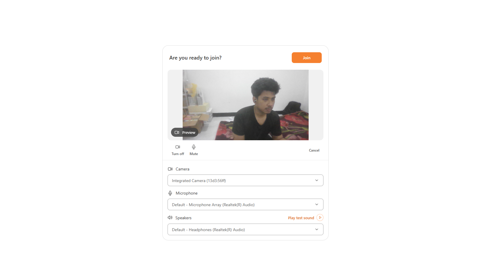
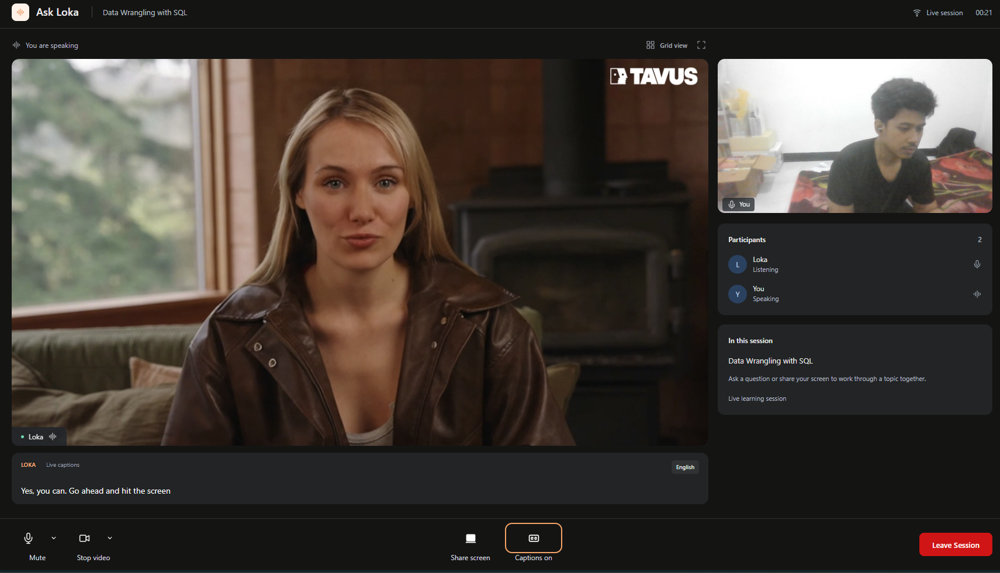
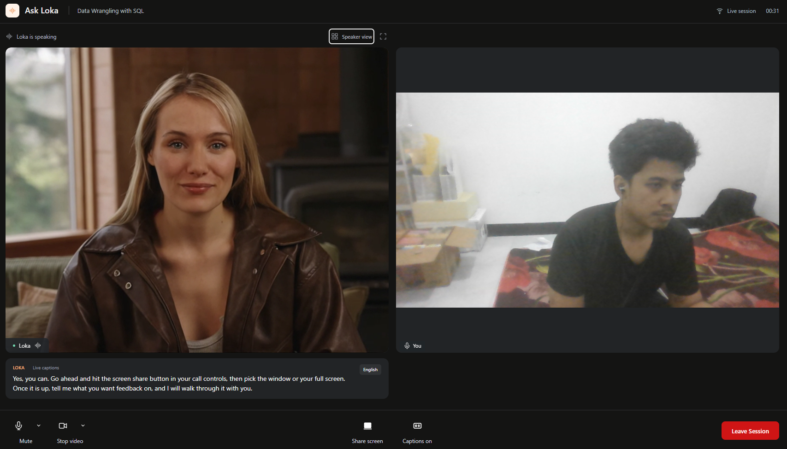
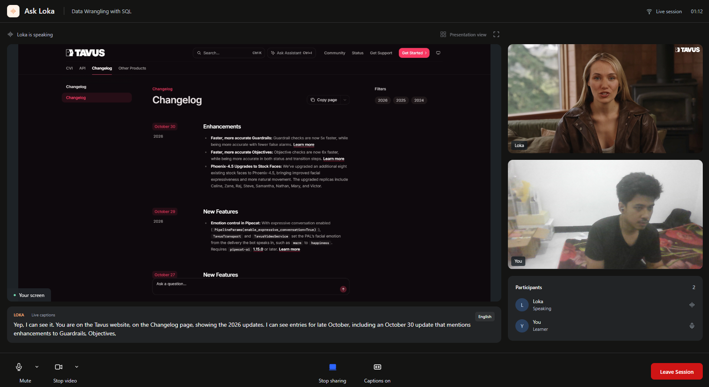

# Ask Loka — Tavus React POC

A React proof of concept for a face-to-face AI learning session using Tavus Conversational Video Interface (CVI) and Daily's video SDK. It demonstrates a custom learning interface with a pre-call device check, live replica video, screen sharing, and streaming closed captions.

The UI is adapted from the [Tavus haircheck and conversation example](https://github.com/Tavus-Engineering/tavus-examples/tree/main/examples/cvi-ui-haircheck-conversation). Tavus UI components and hooks are copied into this project and customized locally.

## Session route previews

The dedicated session route is `/sessions/:bookingId`. For now, only `sample-booking` is a local fixture; other IDs show a not-found state. No backend session is created.

- `/sessions/sample-booking`: schedule-based entry (20 March 2027, 1:00–1:10 PM SGT).
- `/sessions/sample-booking?state=scheduled`: preview the before-session screen.
- `/sessions/sample-booking?state=expired` or `?state=completed`: preview the unavailable screen.
- `/sessions/sample-booking?state=ready`: device check, followed by the demo conversation on Join.

State overrides are local visual-preview tools, not authorization checks. Live booking validation and backend/API hook integration remain pending. Leaving the sample conversation shows its ended state for the current visit.

## App routes

- `/`: sample Ask Loka session dashboard with Scheduled and Completed tabs. Uses local fixture data; cancellation does not call the backend.
- `/?sessionPreview=join`: sample dashboard with the details modal Join action enabled. Open View Details to inspect this state.
- `/welcome`: original conversation URL entry, device check, and live join flow.
- `/?demo`: conversation layout preview without a live session.

## Start here

1. Install dependencies and start the app using [Run locally](#run-locally).
2. Open `http://localhost:5173/?demo` to explore the UI immediately. No API key, environment file, or backend is needed for the demo.
3. Read [How the app works](#how-the-app-works), then open `src/App.tsx` to see the screen flow.
4. Use [Where to make changes](#where-to-make-changes) to find the component relevant to your task.
5. For real AI responses, follow [Join a live conversation](#join-a-live-conversation).

## Tech stack

Versions below describe the dependency ranges in `package.json`; `package-lock.json` pins the installed versions. Use `npm ci` to reproduce them.

| Technology | Version / approach | Role in this repo |
| --- | --- | --- |
| React + React DOM | 19.1 | Renders screens and manages UI state with hooks |
| TypeScript | 5.8 | Checks component props, SDK calls, and event types |
| Vite + React plugin | Vite 7 | Local development, hot updates, and production bundling |
| Daily JS | `^0.80.0` | WebRTC call client: joining, leaving, media devices, and screen sharing |
| Daily React | `^0.22.0` | React provider, video/audio components, and hooks for Daily call state |
| Tavus CVI UI | Generated source | Starting components and event hooks copied into `src/components/cvi/` and customized here |
| CSS Modules | `*.module.css` | Component-scoped styling; `src/index.css` supplies global defaults |
| TanStack Query | v5 | Mutation state, scoped cache keys, and retry defaults for Tutor API calls |
| MSW + Vitest | MSW 2 / Vitest 5 | Opt-in development HTTP mocks plus API and hook tests |
| ESLint | 9 | Static checks, including React hook rules |

**Tavus and Daily have different jobs:** Tavus runs the conversational AI and provides the replica stream and conversation events. Daily carries the real-time media and exposes browser call controls. This repository owns the React interface around them.

Jotai is also declared as a dependency. The entry flow uses React state; new contributors do not need to learn a separate application store to understand `App.tsx`.

## How the app works

```text
main.tsx
  └─ opt-in MSW → QueryClientProvider → TutorApiProvider
       └─ CVIProvider (wraps DailyProvider)
            └─ App.tsx
                 ├─ /              → SessionsHome (local fixtures)
                 ├─ /sessions/:id  → SessionPage → HairCheck → Conversation
                 ├─ /welcome       → URL form → HairCheck → Conversation (live)
                 └─ ?demo          → Conversation with demo=true
```

- **Entry:** `App.tsx` switches on `window.location.pathname` and listens for `popstate`. `/` renders the sessions dashboard, `/sessions/:bookingId` the session route, and `/welcome` the pasted-URL live flow. `?demo` opens the demo conversation directly.
- **Device check:** `HairCheck` starts the local camera/microphone preview and uses Daily device APIs for input/output selection. Speaker testing uses the browser's Web Audio API.
- **Joining:** `Conversation` calls `useCVICall`, which invokes Daily's `join({ url })`. The hook guards against joining again while already joining or joined.
- **Media rendering:** Daily video components render the replica, local camera, or shared screen. Daily audio handles remote sound. React state selects grid or speaker layout; screen sharing uses the presentation layout.
- **Captions:** `cvi-events-hooks.tsx` listens for Daily app messages. `use-closed-caption.tsx` consumes Tavus `conversation.utterance.streaming` events. The caption component displays the latest two visual lines and clears a final caption after a short delay.
- **Leaving:** The leave control opens a shared confirmation dialog. On `/welcome` it calls Daily's `leave()` and returns to the URL form. On the mock session route it ends the session through the controller. Backend session termination remains a separate integration step.

The `/welcome` live entry does not call the Tutor API. The dedicated session route does when `?mock=1`: MSW starts before render, the controller starts and ends the session, and confirmed Leave routes back to the dashboard for feedback. Dashboard cards, cancellation, and history still use local fixtures. Generated chat files remain in the repository but are not mounted in the conversation screen.

## Features

- Camera and microphone check before joining, with device selection and speaker test sound.
- Full-browser conversation layout with replica video, self-preview, participants, and session information.
- Microphone and camera toggles, device dropdowns, and hover tooltips.
- Camera tile stays visible with a placeholder when video is off.
- Speaker and grid layouts, plus a fullscreen control.
- Screen sharing with a presentation layout that keeps both camera previews visible. Grid switching is disabled while sharing.
- Closed captions showing the latest two lines in a fixed strip, keeping video size stable.
- Active speaker indicators, microphone status, elapsed session timer, and network information on hover.
- Demo mode for reviewing the layout without creating a Tavus conversation.

## Screenshots

### Pre-call device check

Preview your camera, select input and output devices, and test your speakers before joining.



### Speaker view

The replica takes the main stage, with your camera, participant status, and learning context in the sidebar. Captions appear below the main video.



### Grid view

Display the replica and your camera side by side.



### Screen sharing

Shared content takes the main stage while the replica and your camera remain visible in the sidebar.



## Run locally

Use Node.js 22.12+ and npm.

```sh
npm ci
npm run dev
```

Open the URL printed by Vite, usually http://localhost:5173. Camera, microphone, and screen sharing require browser permissions and a secure context such as localhost or HTTPS.

### Join a live conversation

1. Create an active Tavus conversation through your backend or existing integration.
2. Copy the exact `conversation_url` returned by that integration.
3. Paste it into the app's Conversation URL field.
4. Check your devices, then click **Join**.

The client joins through Daily's SDK, so provide the underlying SDK-compatible room URL. A Tavus Maker webpage link is not interchangeable with that room URL. Use the returned URL rather than constructing one from a conversation ID.

The entry flow does not create a backend session or ask for an API key. Keep Tavus credentials on your backend. This UI currently accepts a room URL only; rooms requiring a separate meeting token need additional join credential handling.

**Leave Session** disconnects the browser from the call. It does not call your backend to terminate the Tavus conversation.

### Preview without a live conversation

Open http://localhost:5173/?demo or select **Preview conversation UI (demo)** on the entry screen.

Demo mode shows a replica placeholder and sample captions. You can optionally enable your real camera and microphone to try the local preview and controls. It does not create a Tavus session or produce AI responses. The demo timer remains at `00:00`.

## Integration roadmap

Plan 1 is complete: a typed Tutor API client, reusable React Query hooks, deterministic MSW scenarios, and tests exist under `src/api/tutor.ts`, `src/hooks/tutor/`, and `src/mocks/`. The booking read/cancellation hooks are not mounted by screens; the session controller uses the start/end mutations on the mock-backed session route.

Plan 2's `useTutorSession` controller and mock media adapter are implemented for `/sessions/:bookingId?mock=1`. Next is a real media adapter, authentication for the session route, and live API wiring. See the [frontend integration plan](docs/frontend-integration-plan.md) for scope and validation scenarios, and [Tutor API client, hooks, and mocks](docs/frontend-api-and-mocks.md) for configuration, auth, retry semantics, and current wiring. In development, `main.tsx` awaits MSW when mocks are enabled and mounts `QueryClientProvider` and `TutorApiProvider`.

## Live and demo conversation screens

Live and demo calls render the **same `Conversation` component** in `src/components/cvi/components/conversation/index.tsx`. There is no separate demo screen to maintain. Changes to the layout, toolbar, sidebar, captions presentation, camera-off placeholders, tooltips, and session dialogs apply to both modes.

```tsx
// Live: joins the supplied Daily/Tavus room.
<Conversation conversationUrl={url} onLeave={handleLeave} />

// Demo: skips the remote room join.
<Conversation demo conversationUrl="" onLeave={handleLeave} />
```

| Behavior | Live mode | Demo mode |
| --- | --- | --- |
| Main video | Real Tavus replica stream | Labeled replica placeholder |
| Local camera/mic | Real devices with browser permissions | Optional real devices with browser permissions |
| Captions | Tavus streaming utterance events | Sample caption text |
| Participant/speaking data | Daily participants and active speaker | Sample participant information |
| Session timer | Elapsed time since the local call joined | `00:00` |
| Media controls and layout | Shared component | Shared component |
| Leave confirmation and error dialogs | Shared dialogs with live retry behavior | Shared dialogs with local preview behavior |
| Backend session termination | Not connected to this screen yet | No backend conversation is created |

The existing live entry is `/welcome`: paste an active room URL, check devices, then join. The dedicated sample route `/sessions/sample-ready-booking` runs the device check and then opens the demo conversation. `/?demo` opens the demo conversation directly.

For dialog previews, use `/?demo&dialog=leave`, `/?demo&dialog=connection`, or `/?demo&dialog=microphone`. These previews do not simulate a real provider connection failure.

**Development rule:** change the shared component and its CSS Module for visual updates. Keep only provider joining, live media/events, and sample data conditional on `demo`. Verify changes in both modes; a successful demo does not verify remote audio/video, live caption delivery, or backend session lifecycle.

## Development

| Command | Purpose |
| --- | --- |
| `npm run dev` | Start the Vite development server |
| `npm run build` | Type-check and create a production build in `dist/` |
| `npm run preview` | Serve the production build locally |
| `npm run lint` | Run ESLint |
| `npm test` | Run Vitest API and hook tests with MSW Node |
| `npm run test:watch` | Run Vitest in watch mode |

## Project structure

```text
src/
  App.tsx                         # Path-based entry: dashboard, session route, live flow
  main.tsx                        # React entry, opt-in MSW bootstrap, and providers
  api/tutor.ts                    # Typed Tutor API client
  fixtures/tutor.ts               # Shared synthetic booking/session metadata
  session-navigation.ts           # In-app pushState navigation helper
  hooks/tutor/                    # React Query hooks, session controller, keys, provider
  mocks/                          # MSW fixtures, scenarios, handlers, and bootstraps
  test/setup.ts                   # Vitest + Testing Library setup
  components/
    sessions-home/                # Ask Loka dashboard, details, and cancellation dialogs
    session-page/                 # /sessions/:bookingId states and device check
    session-feedback/             # Post-session rating and comments dialog
    cvi/
      components/
        cvi-provider/             # Daily React context
        hair-check/               # Pre-call preview and device settings
        conversation/             # Session layout and presentation/grid modes
        session-dialog/           # Leave, connection, and microphone dialogs
        device-select/            # Media controls and device dropdowns
        closed-captions/          # Caption toggle and two-line display
      hooks/                      # Call lifecycle, devices, and Tavus event handling
docs/frontend-api-and-mocks.md    # API/hook/mock usage and future wiring
docs/screenshots/                 # README screenshots
```

Additional generated components and API helpers may exist in the source tree; the active conversation UI does not include chat.

## Where to make changes

Paths below are relative to the repository root. Component folders contain `index.tsx` and their associated CSS Module.

| Task | Start here |
| --- | --- |
| Change route selection or switch between demo/live | `src/App.tsx` |
| Change the sessions dashboard, cancellation, or details dialog | `src/components/sessions-home/` |
| Change session-route states, device check, or mock join | `src/components/session-page/` |
| Change post-session feedback | `src/components/session-feedback/` |
| Change pre-call device check | `src/components/cvi/components/hair-check/` |
| Change session header, sidebar, grid, or presentation layout | `src/components/cvi/components/conversation/` |
| Change mic, camera, screen-share controls or dropdowns | `src/components/cvi/components/device-select/` |
| Change caption appearance or CC button | `src/components/cvi/components/closed-captions/` |
| Change caption event handling / clear delay | `src/components/cvi/hooks/use-closed-caption.tsx` |
| Change join/leave behavior or add meeting-token support | `src/components/cvi/hooks/use-cvi-call.tsx` |
| Change device initialization | `src/components/cvi/hooks/use-start-haircheck.tsx` |
| Inspect Tavus event types and subscription helpers | `src/components/cvi/hooks/cvi-events-hooks.tsx` |
| Change Tutor API calls, auth headers, or errors | `src/api/tutor.ts` |
| Change Tutor hooks, session controller, retry defaults, or cache keys | `src/hooks/tutor/` |
| Change mock scenarios, fixtures, or MSW bootstraps | `src/mocks/` |
| Change global styles | `src/index.css` |

Edit generated Tavus files like normal application source. Re-running the Tavus component generator can replace local customizations, so inspect its proposed changes before accepting replacements.

### Check your changes

Run `npm run build` for TypeScript and production bundling, `npm run lint` for static checks, and `npm test` for the Vitest/MSW API and hook suites. Add or update MSW Node tests when changing the Tutor client, hooks, or scenarios.

For UI changes, check the following manually:

- Open demo mode and toggle captions, grid view, and fullscreen.
- Enable devices, mute/unmute, and switch the camera off/on. The camera tile should retain its size.
- Resize to desktop and mobile widths; verify captions and controls stay readable.
- With an active conversation, verify two-way audio, streaming captions, and screen sharing. Stop sharing and confirm the normal layout returns.

Demo mode verifies layout and local media controls. It does not verify backend session creation, remote media, real AI responses, or live caption events.

## Implementation notes

- **Stack:** React 19, TypeScript, Vite, CSS Modules, `@daily-co/daily-react`, and `@daily-co/daily-js`.
- **Tutor API layer:** Plan 1 ships a typed client, React Query hooks, and opt-in MSW mocks. The session controller uses the start/end mutations; booking reads and cancellation are not mounted by screens yet. See `docs/frontend-api-and-mocks.md`.
- **Media:** Daily supplies camera, microphone, screen tracks, and participant state; React components control their layout.
- **Captions:** Tavus streaming utterance events feed the caption display. Live captions depend on the session emitting these events.
- **Branding:** “Ask Loka” and “Data Wrangling with SQL” are currently hard-coded demonstration labels, not backend course metadata.
- **Scope:** This is a frontend proof of concept. Booking, authentication, session creation, and backend session termination belong to the integrating application.

## Troubleshooting

- **Room fails to join:** Check that the room URL is correct and the conversation is still active. Obtain a fresh session when necessary.
- **No camera or microphone:** Check browser and operating-system permissions and select an available device.
- **No captions:** Enable the CC control and verify that the live session emits streaming utterance events.
- **Screen sharing stops:** Re-select a screen, window, or tab through the browser's sharing prompt. Ending sharing restores the regular layout.

### Post-session feedback previews

Confirmed Leave disconnects Daily, returns to `/`, and opens the Ended Early feedback modal. Feedback currently stays in local UI state; the API hooks are not wired to this form. Backend termination remains separate.

- `/?sessionOutcome=early&duration=120`: early exit.
- `/?sessionOutcome=completed&duration=600`: completed-session preview.
- `/?sessionOutcome=interrupted`: interrupted-session preview; no incident reference is fabricated.

Completed and interrupted previews are not yet triggered automatically by backend lifecycle events. Rating is required; written feedback is optional (maximum 2000 characters).

### Session list empty states

Use `/?empty=scheduled`, `/?empty=completed` (select Completed), or `/?empty=all` to preview the list empty states. Scheduled also becomes empty after both sample bookings are cancelled. Tab counts reflect the displayed local data.

## Mock-backed session integration

In development, open `/sessions/sample-ready-booking?mock=1` (linked from the second scheduled card). MSW starts before rendering. Device check → Join calls mocked start → mock media opens the shared demo conversation → confirmed Leave calls mocked end → homepage feedback calls mocked submit. Success toast follows the successful response. In-app navigation preserves the mock store across the homepage transition.

Mock media never joins synthetic Daily URLs. `?mock=1` is development-only. Existing `/welcome` live calls and `/?demo` visual previews remain separate. Real session-route authentication/media integration, automatic lifecycle outcomes, and dashboard read/cancellation wiring remain pending.

Reloading resets the mock store. Feedback after reload can return SESSION_NOT_ENDED. Preview query parameters are not authorization checks.
